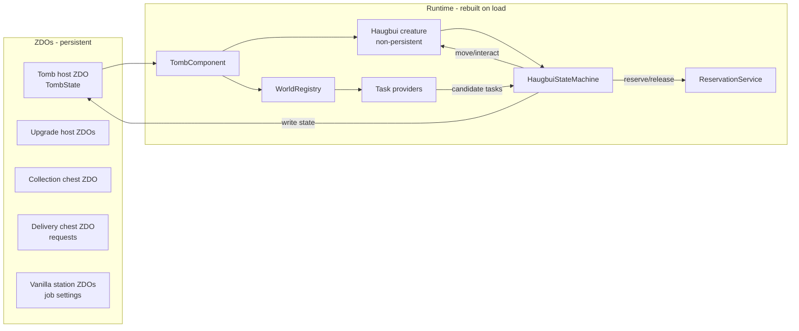
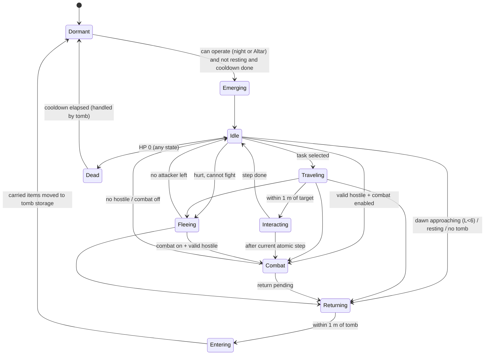
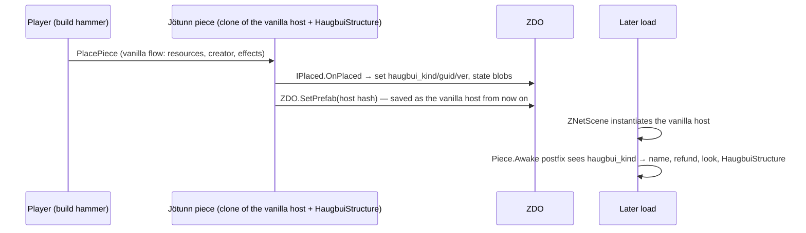

# Haugbui — Architecture

Target: Valheim 1.0.20 · BepInEx 5.4.23 · Jötunn 2.30.2 · C# / .NET Framework 4.8 (Windows). Notes marked
"1.0.17" were verified on that version; the API manifest passes on 1.0.20.
Companion documents: `TECHNICAL_FEASIBILITY.md` (verified facts), `PRODUCT_REQUIREMENTS.md` (behaviour).

## 1. Principles

1. **The world is the database.** All persistent state lives in ZDO keys on world objects (tomb, chests, stations).
   Runtime objects are caches that can be rebuilt from ZDOs at any time.
2. **The Haugbui creature is a projection of its tomb.** It is non-persistent; the tomb ZDO owns its HP, carried
   inventory, death time and settings. Spawning/despawning the creature never loses data.
3. **One brain, one actuator.** Only the `HaugbuiStateMachine` issues movement and interaction commands. Feature
   systems (storage, delivery, harvest, production, combat) *propose* tasks; they never move the creature.
4. **Game access is isolated.** Every call into Valheim types (RPC names, ZDO keys, private fields) goes through the
   `Integration/` adapter layer, so a game update breaks one place, and the domain logic stays unit-testable.
5. **Transfers are single-frame and owner-checked.** An item leaves a source and enters a destination in the same
   frame, only when this peer owns both ZDOs. World saves snapshot ZDOs on the main thread between frames, so a save never
   observes a half-moved item. [V — spike HB-T-009, 2026-10-13: 120 s of random destination-first moves between two
   chests with a forced save every 5 s, then reload: item totals unchanged]
6. **Owner-authoritative execution.** All Haugbui logic runs only on the peer that owns the tomb's ZDO (in
   single-player: the local player). This keeps the door open to server-authoritative multiplayer.
7. **No custom items. Host prefabs for structures.** See feasibility §9.2.

## 2. Solution layout

```
haugbui-valheim-mod/
├─ Haugbui.sln
├─ Directory.Build.props        (version, VALHEIM_INSTALL / VALHEIM_MANAGED resolution, imports Environment.props)
├─ Environment.props            (git-ignored, per developer: VALHEIM_INSTALL, MOD_DEPLOYPATH)
├─ nuget.config                 (nuget.org + BepInEx feed)
├─ src/
│  ├─ Haugbui/                  (BepInEx plugin, net48; Jötunn/BepInEx compile-only; game DLLs publicized at build)
│  │  ├─ HaugbuiPlugin.cs
│  │  ├─ Config/                HaugbuiConfig, ProgressionTable binding
│  │  ├─ Integration/           adapters over Valheim: ZdoKeys, GameApiSelfCheck, ContainerGateway, ItemDropGateway,
│  │  │                         StationAdapters/, PickableGateway, AccessPolicy, TimeSource, PlacementRules
│  │  ├─ Registry/              WorldRegistry (containers, stations, harvestables, item drops, beds), spatial index
│  │  ├─ Structures/            HostPrefabSystem, TombComponent, UpgradeComponent, CollectionChest, DeliveryChest
│  │  ├─ Creature/              HaugbuiCreature (prefab setup), HaugbuiController, Movement, Visuals, Combat actuator
│  │  ├─ Brain/                 HaugbuiStateMachine, TaskPlanner, ITaskProvider implementations
│  │  ├─ Coordination/          ReservationService
│  │  ├─ Persistence/           TombState, StationJobState, DeliveryRequestState (ZDO serializers), WorldGuard
│  │  ├─ UI/                    TombPanel, DeliveryPanel, ProductionPanel, CountdownLabel, Warnings
│  │  ├─ Patches/               Harmony patches (thin; delegate to systems)
│  │  ├─ Diagnostics/           Log, console commands (haugbui_status, haugbui_dump_prefabs, ...)
│  │  ├─ Spikes/                DEBUG-only spike commands (HB-T-007/009/090)
│  │  └─ Translations/          English/haugbui.json, Portuguese_Brazilian/haugbui.json (auto-loaded by Jötunn)
│  └─ Haugbui.Core/             (netstandard2.0, NO Unity/Valheim refs) pure domain logic:
│                               ProgressionTable, TickScheduler, PieceRecipe/RecipeValidator, GameApiManifest/Checker,
│                               ItemRules, StorageSelector, DeliveryLedger, ProductionJob, ReservationTable,
│                               cooldown math, state-machine transition rules
├─ tests/
│  └─ Haugbui.Core.Tests/       (NUnit, runs with `dotnet test` without the game)
├─ docs/
└─ .reference/                  (git-ignored: game DLLs + decompiled source for API lookup only)
```

`Haugbui.Core` is merged into the plugin assembly at build time (ILRepack) or shipped as a second DLL in the same
plugin folder (simpler; chosen by default).

## 3. Component map

| Concept (spec §23-C) | Implementation | Layer |
|---|---|---|
| HaugbuiPlugin | `HaugbuiPlugin : BaseUnityPlugin` — `[BepInPlugin]`, `[BepInDependency(Jotunn)]`, `[NetworkCompatibility(EveryoneMustHaveMod, Minor)]`; wires config, localization, prefabs, patches, registries | Plugin |
| HaugbuiConfiguration | `HaugbuiConfig` (BepInEx `ConfigFile` bindings, admin-only flags for future sync) | Config |
| HaugbuiLocalization | `HaugbuiLocalization` (`LocalizationManager.Instance.GetLocalization()`; token helper `L.T("haugbui_x")`) | Localization |
| HaugbuiAttributes | `ProgressionTable` (Core) + `HaugbuiAttributes` snapshot (level → capacity, speed, radius, slots, HP) | Core |
| HaugbuiTomb | `TombComponent` (MonoBehaviour on the tomb host) + `TombState` (ZDO-backed) | Structures/Persistence |
| HaugbuiUpgradeManager | `UpgradeComponent` + `TombLevelService` (level = 1 + distinct bound upgrades, any order; abilities granted per upgrade kind) | Structures |
| HaugbuiController | `HaugbuiController` (on the creature) — owns references to state machine, movement, inventory view, visuals | Creature |
| HaugbuiStateMachine | `HaugbuiStateMachine` (Brain) — single source of movement/interaction commands | Brain |
| HaugbuiMovementController | `HaugbuiMovement` — kinematic flight, arrival detection (≤1 m), smoothing | Creature |
| HaugbuiInventory | `CarriedInventory` — wraps a vanilla `Inventory(w=slots,h=1)` + weight cap; serialised into tomb ZDO | Persistence |
| HaugbuiStorageManager | `StorageTaskProvider` + `StorageSelector` (Core) | Brain/Core |
| HaugbuiCollectionManager | `CollectionTaskProvider` (Collection Chest + ground items) | Brain |
| HaugbuiDeliveryManager | `DeliveryTaskProvider` + `DeliveryLedger` (Core) | Brain/Core |
| HaugbuiHarvestManager | `HarvestTaskProvider` + `PickableGateway` | Brain/Game |
| HaugbuiCombatManager | `CombatTaskProvider` (interrupt source) + `CombatActuator` | Brain/Creature |
| HaugbuiProductionManager | `ProductionTaskProvider` + `ProductionJob` (Core) | Brain/Core |
| ProductionStationAdapter | `IStationAdapter` + `SmelterAdapter`, `FermenterAdapter`, `CookingStationAdapter`, `FuelOnlyAdapter` | Game |
| HaugbuiPersistenceManager | `ZdoStore` (typed get/set, versioned blobs), `WorldGuard` (marker, detection, backup) | Persistence |
| (coordination) | `ReservationService` (in-memory leases) + persistent job ownership on station ZDO | Coordination |
| (access) | `IAccessPolicy` → `SinglePlayerAccessPolicy` (wards via `PrivateArea.CheckAccess`, container privacy) | Game |
| (time) | `ITimeSource` → `WorldTimeSource` (`ZNet.GetTimeSeconds`, `EnvMan.IsNight/IsDay/GetDayFraction`) | Game |

## 4. Runtime topology



- `WorldRegistry` keeps live sets of containers, stations, pickables, beehives, item drops, beds, Haugbui
  structures, populated by Harmony postfixes on `Awake` (`ShieldGenerator.Start`; vanilla has no container list); a
  small `RegistryTracker` component removes the entry when Unity destroys the object, since most of these classes have
  no `OnDestroy`. Item drops and characters move, so they come from `ItemDrop.s_instances` and
  `Character.GetAllCharacters()`. Static objects use a spatial hash (cell 16 m, queries fill a caller-owned list and do
  not allocate); carts, ships and attached sub-containers are not indexed. The registry is cleared on world load
  (`ZNetScene.Awake`) and `haugbui_registry` compares it with a full scene scan.
- `TombComponent` (owner-only `Update` at a configurable tick, default 0.5 s) decides whether the creature should exist
  (night/level/cooldown/resting/new-tomb start, then the shift payment of §5.2), spawns it at the tomb (emergence VFX) or
  recalls it.
- The creature's `HaugbuiController` runs the state machine at its own tick (default 0.25 s) with movement in `Update`.

## 5. State machine

States (persisted subset in **bold** inside `TombState.state`):



- **Dormant / Dead / Cooldown** are tomb states (creature absent). **Emerging, Idle, Traveling, Interacting, Combat,
  Returning, Entering** exist only while the creature is spawned.
- Interrupts: Combat > Returning(dawn) > tasks. An interrupt never splits an atomic interaction step (e.g. moving one
  stack); it waits for the step to finish (≤ 1 tick). A fight in progress ends into a pending return; no new fight
  starts once a return is pending or under way (M8).
- On load, a spawned creature never resumes mid-task: the tomb respawns it (if allowed and its shift is paid) at its last
  saved position or at the tomb, in Idle, and tasks are re-planned from persistent state.

### 5.2 Presence, shifts and tribute (M6)

All times come from world time (`ZNet.GetTimeSeconds`) through `WorldClock` (Core): EnvMan (1.0.17) rescales the raw
part of the day 0.15..0.85 to the visible fraction 0.25..0.75 and calls "night" a visible fraction ≤ 0.25 or ≥ 0.75, so
night is raw ≤ 0.15 or ≥ 0.85 (30% of the day). Computing it from world time instead of `EnvMan.IsNight` drops the
smoothing lag and lets the mod store absolute times (next dusk, shift ends). Day d has the day shift `2d` and the night
shift `2d+1`, which also covers the hours after midnight of day d+1.

`PresencePolicy.ShouldBeOut` (the work window): not resting; not before `StartTime` (HB-136, a new tomb's first dusk);
not before the return time of a death (HB-133: cooldown `CooldownDays × day length`, then the first dusk at or after it
without the Altar, at once with it); then at night before the dawn lead, or always with the Altar. `WaitRemaining` (the
later of start and return) feeds the countdown label and the hover.

Inside the window `TombController.StartShift` (HB-T-101) decides with `ShiftRules`: tribute off → free; shift already
paid (`LastPaidShift`) → work; else every `WorkCheckSeconds` it asks `HaugbuiWorker.HasWork` (all task providers on a
separate probe `WorkContext`, nothing reserved, the Collection Chest interval ignored) and charges the shift cost of
its level when there is work and enough balance, otherwise stays dormant with "no work" / "no tribute". The same check
runs when a new shift starts while it is out (Altar: dusk and dawn); without work or credit it goes home. Death clears
`LastPaidShift`, so every return is charged. `StartShift` is the hook away mode and sleep fast mode will call.

Tribute (HB-166/159): `TributeBalance` keeps the total and the part paid with cheated valuables; charges spend the
cheated part first, so a refund never gives back more clean coins than were offered clean. Offering takes one item
from the player's inventory (`Inventory.RemoveItem`) and adds its value. On tomb destruction the balance drops as Coins
(clean and cheated stacks) or is forfeited (`TributeOnTombDestroyed`).

Servant slots (HB-137..139): `ServantRegistry` keeps one global key per slot, `haugbui_slot_<ownerId>_<n> <hex>`
(name, bound tomb GUID, pending death time, toggles). A new tomb binds the lowest slot whose tomb no longer exists
(loaded or found in `ZDOMan.m_objectsByID`) and inherits its name, pending death and toggles; placement is refused when
none is free (`MaxHaugbuisPerPlayer`). Tombs from before 0.0.6 bind on load in GUID order. Destroying a tomb only clears
the slot's tomb GUID.

### 5.1 Task model

```csharp
interface ITaskProvider {
  TaskKind Kind { get; }
  bool IsEnabled(TombSnapshot tomb);                 // toggles, level gates
  void Collect(PlanningContext ctx, List<TaskCandidate> output);  // cheap, time-sliced
}
sealed class TaskCandidate {
  TaskKind Kind; int Priority; Vector3 FirstTarget; ReservationKey[] Keys; Func<TaskPlan> Build;
}
```

Planner picks the highest-priority candidate whose reservation keys are all free, reserves them, builds a `TaskPlan`
(ordered steps: `GoTo(target)`, `Take(container,item,n)`, `Put(container,item,n)`, `Pick(pickable)`,
`Extract(beehive)`, `Feed(station, item, n)`, `CollectOutputs(station)`, `PickUpDrop(drop)`), and executes it.

Default priority order (configurable later): Combat (interrupt) → deposit when carried inventory full → production
output pickup (avoid ground clutter) → production feeding → delivery requests → harvesting → collection chest →
ground items → idle hover near tomb.

M7 priorities: production outputs 80, production feeding 75 (§9). M6 priorities: deposit 100, delivery 70, leftover drops of its own harvests 61, harvesting 60, sorting tomb storage 50,
Collection Chests 45, ground items 40. Harvest and ground-item tasks are one trip through the nearest targets (next
stop ≤ 10 m from the last, ≤ 8 stops) whose items the carried inventory can take whole (`PickupRoute`, Core); both
require a storage destination for the product (HB-065/091). A harvest step calls the target's own RPC
(`Pickable.RPC_Pick`, `Beehive`/`SapCollector.RPC_Extract`) through `HarvestGateway`; an RPC to the local owner runs at
once, so the new drops are found by diffing `ItemDrop.s_instances` and picked up in the same step (`DropEndpoint`,
destination first). Drops that do not fit are remembered for 5 minutes and collected even with the ground toggle off
(HB-093). Crops are `Pickable.m_harvestable` (the scythe's flag); wild pickables and sap collectors only by config.

## 6. Coordination between Haugbuis

- **Same owner (HB-T-110, decision 2026-10-14):** tombs of one owner are at least `TombSpacingSameOwner` (100 m) apart.
  With `TerritoryMode` each `WorkContext` lists the owner's loaded tombs and keeps only targets whose nearest covering
  tomb (`Territory.OwnerOf`, Core; ties to the lowest GUID) is its own: deposit destinations, Collection and Delivery
  Chests, stations (a job claimed by another tomb of the same owner is taken over at once), crops, hives, nests and
  ground items. Plain storage chests stay shared as sources. Other owners are not affected.

- `ReservationService` (singleton per world session) maps `ReservationKey` (`ZDOID` of target + optional item
  prefab hash/slot) to `{tombId, leaseExpiry}`. Leases default 30 s, renewed while the task runs, released on
  completion, on creature despawn/death, and **cleared entirely on world load** (never persisted).
- Keys used:
  - Ground item drop → its ZDOID (exclusive).
  - Pickable/beehive/nest → ZDOID (exclusive).
  - Container *for writing* → ZDOID (exclusive for the duration of a single Take/Put step only).
  - Station → ZDOID (exclusive while feeding/collecting).
  - Delivery request line → (chest ZDOID, item hash).
  - M6: `drop:<ZDOID>` per ground item of a trip, `harvest:<ZDOID>` per crop, hive or nest.
- **Persistent ownership** (survives reloads): a station's automation job stores `haugbui_job_tomb = <tombGuid>`. The
  first Haugbui whose radius covers it claims it; others skip it. If the owning tomb is gone/unloaded for > N minutes
  of world time, another tomb may take over. The Delivery Chest is served by any Haugbui (ledger is on the chest).
- Capacity races are impossible in single-player because all transfers are single-frame on the same peer;
  reservations prevent *planning* conflicts (two Haugbuis flying to the same drop).
- M5 keys: a Collection Chest task reserves `take:<chest ZDOID>`; a delivery trip reserves
  `deliver:<chest ZDOID>:<item prefab>` (one Haugbui per request line). `WorkContext` sorts every loaded container in
  the radius by role (`ContainerUse`): storage destination, storage source (plain chests and Collection Chests) and
  delivery target (Delivery Chests only). A delivery trip (`DeliveryPlanner`, Core) takes no more than the line's
  remaining amount, the chest's room and the carry limits, takes carried items of that item first, then the nearest
  sources; each Put into the Delivery Chest counts the moved amount in its ledger (`haugbui_requests`, owner writes
  only). Leftovers of an aborted trip are deposited like any carried item. The Collection Chest check repeats every
  `CollectionIntervalSeconds` of world time while it finds nothing, every planning tick while it has work.
- M4 keys: sorting a tomb storage reserves `take:<container ZDOID>` (only its own tomb uses it, the key makes that
  explicit). Deposits reserve nothing: the destination's room is re-read when the item is put, and what does not fit
  stays carried and is re-planned. Leases use game time (`Time.timeAsDouble`), the lease length is
  `Advanced.ReservationLeaseSeconds`, and `haugbui_reservations` lists them.

### 6.1 Worker (M4)

`HaugbuiWorker` (one per tomb, on the owner) plans every `PlanningIntervalSeconds` through the shared `TickScheduler`
while the creature is Idle and no return is pending, and right after a step that moved items. Providers: deposit
carried items (priority 100), delivery requests (70, M5), sort tomb storage (50), Collection Chests (45, M5). A step resolves its target from the registry snapshot of that
planning tick; a target that is gone or unloaded aborts the task (HB-033: unloaded is "unavailable", never "empty").
Travel has a timeout; a step that moved nothing puts the item kind on the `RetryBackoff` (2 s doubling to 60 s of world
time), which also marks kinds without a destination so sources skip them (HB-065). Death, entering the tomb, despawn
or unload release every lease of that tomb. The panel shows the activity and, every 10 s, the share of the
operational disc in loaded zones (`ZoneSystem.IsZoneLoaded` + `ZNetScene.InActiveArea`).

## 7. Inventory and transfer service

`TransferService.Move(source, destination, itemPrefab, amount)`:
1. Validate both ends exist, are loaded, are owned by this peer (`ZNetView.IsOwner()`; request ownership through the
   vanilla flow otherwise and retry next tick), are not `IsInUse()`, pass `IAccessPolicy`.
2. Compute `n = min(amount, available in source, capacity in destination (slots + stacks), weight cap if destination is
   the carried inventory)`.
3. **Destination first, then source** (same principle as the "Dvergr Tidier" mod: "every move puts the item in its
   destination before removing it from where it was"): add `n` to the destination preserving `ItemData` fields
   (`m_quality`, `m_worldLevel`, `m_cheated`, `m_customData`), read back how many were actually accepted, then remove
   exactly that amount from the source — all in the same frame. A failure can therefore never lose an item; the worst
   case (a crash between the two writes, only possible in future multiplayer) is a duplicate, never a loss. Never call
   `Inventory.AddItem(..., dropIfFullInv: true)`.
   Verified pitfalls of `Inventory.AddItem(ItemData)` (Inventory.cs:112, 1.0.17; no longer used, see the stacking rule below): it **inserts the instance it receives**
   and mutates its `m_stack`/`m_gridPos`, so always pass `item.Clone()`; and when the stack only partly fits it tops up
   existing stacks first and then returns `false` **without rolling back** what it already added. Always check
   `CanAddItem` first. `CanAddItem` counts stack space by name and world level but `AddItem` stacks by name, quality
   and world level, so for quality > 1 items compute capacity with the quality-aware rule in Core.
4. Persist: containers save themselves via `OnContainerChanged` (owner); carried inventory is serialised into the tomb
   ZDO immediately.
5. Debug ledger (when `DebugLogging`): log `{tomb, op, item, n, src, dst, totals before/after}` to detect drift.

Implementation (M4): `TransferEngine` (Core) runs these steps over `IItemEndpoint`s — `ContainerEndpoint` (vanilla
container: loaded, ZDO owner, not in use, inventory loaded) and `CarriedEndpoint`. A source that gives less than was
added (exception or short removal) has the surplus taken back from the destination; the property test runs 10 000
random transfers with injected failures. `ItemStack` keeps the cheated flag, crafter and custom data (blob v2).
**Stacking rule (HB-061, decision 2026-10-13):** items join an existing stack only when their data is identical
(`ItemStack.StacksWith`: prefab, quality, world level, variant, cheated, crafter, custom data). Endpoints count, add and
remove identical items only, so a transfer never changes any item's flag in either direction. The game's public
`Inventory.AddItem` overloads are never used for this: both merge by name, quality and world level only (`FindFreeStackItem`),
and `AddItem(ItemData)` sets `m_cheated` on the target stack when a cheated item joins it (Inventory.cs:112, 1.0.17).
`ItemBridge.AddTo` tops up identical stacks and then fills empty slots through the private
`Inventory.AddItem(item, amount, x, y)`, which stacks only onto the item in that slot and never writes `m_cheated`
(it raises `Changed` only while a local player exists, so `AddTo` raises it otherwise). Room and the storage selector
count identical stacks plus empty slots. **Optional (HB-T-109, decision 2026-10-14):** with `StrictItemData` OFF,
`StackingRules` lets an item top up any chest stack of the same item, quality and world level and applies the vanilla
result (a cheated item makes the stack cheated; the stack keeps its own custom data and crafter). Sources still give
identical items and the carried inventory stays strict, so no flag is ever cleared; the transfer record then measures
the whole kind and a rollback removes identical items first, then the same kind. The smelter queue rule becomes "never
a clean item into a cheated queue". Verified pitfall: every ZDO key change
on a piece (support, snow, Haugbui state) bumps `DataRevision`, so container freshness cannot be judged by comparing
revisions; only "never loaded yet" (`m_lastRevision == uint.MaxValue`, inventory still empty in memory) blocks writes.
`haugbui_ledger` prints the recent records; a non-conserved record is logged as an error.

**Interruption rule:** whenever the Haugbui stops working (dawn, Rest toggle, death, tomb unloaded, combat flee that
ends at the tomb), everything it carries is moved to **tomb storage**, which the player can open at any time. When it
emerges again, tomb storage is its first sorting source (like a Collection Chest). The player can therefore always
take what the servant was carrying while it sleeps, and nothing stays "in limbo".

Carried inventory = vanilla `Inventory(name, null, slots, 1)`, weight checked manually (vanilla `CanAddItem` ignores
weight). Equipment filter applied at every entry point via `ItemRules.IsTransportable(ItemData)` (Core).

## 8. Persistence model

All keys are namespaced `haugbui_*` and versioned. Blobs are `ZPackage` byte arrays with a leading schema version.

| Object | Keys |
|---|---|
| Any Haugbui host | `haugbui_kind` (int, `StructureKind`: Tomb 1, Offering 10, PersonalTreasure 11, SilverBracelets 12, Longsword 13, Altar 14, CollectionChest 20, DeliveryChest 21), `haugbui_ver` (int), `haugbui_guid` (string) |
| Tomb | `haugbui_tomb` (versioned blob `TombState` v3: guid, owner playerID, toggles bitmask, health, death time, level cache, creature state, position, health time; v3 adds servant slot index, tribute balance, cheated part of the balance, last paid shift, start time), `haugbui_carried` / `haugbui_overflow` (`ItemStack` lists) |
| Upgrade | `haugbui_tomb_guid` (binding, written on placement), upgrade kind in `haugbui_kind` |
| Delivery chest | `haugbui_requests` (byte[]: list of {itemPrefab, requested, delivered}) |
| Vanilla station | `haugbui_job` (byte[]: {enabled, recipe input/output prefab, mode finite/infinite, target, supplied, produced, tombGuid}) |
| World | global key `haugbui <schemaVersion>` (schema 1) and `haugbui_tombs <count>` (tomb ZDOs from `ZDOMan.m_objectsByID`, not servant slots); servant slots `haugbui_slot_<ownerId>_<n> <lower-case hex of ServantSlot blob>` (written directly to `ZoneSystem.m_globalKeys`/`m_globalKeysValues`: `SetGlobalKey` would route an RPC and add every new text to the player profile's known keys; the world load lower-cases the whole key text, hence hex for slots and plain numbers for the marker; not synced to other peers yet) |

Rules:
- Never write defaults over existing data: readers return `null` for missing blobs; writers only run after a successful
  read (protects against wiping data on partial load).
- Schema migration functions per blob version; unknown future versions → read-only + warning.
- Level is **recomputed** from upgrades in range; the cached value is only for UI when upgrades are unloaded.

### 8.1 Host-prefab system



The placed object is never swapped: only its ZDO prefab hash changes, which the game reads only when it instantiates
objects (verified: `ZNetScene.CreateObject`, no instance/ZDO prefab consistency check). Implemented in
`Structures/HostPrefabSystem.cs` (M2).

Supporting patches: deconstruction refund (drop Haugbui recipe instead of host cost), hover/interact override,
`Container.Awake` adjustments (size/name) before `Load`, exclusion from vanilla/3rd-party auto-storage where possible
(`MUC_Ignore`). **Decision (spike HB-T-007, 2026-10-13): go.** The `Container.Awake` postfix, look swap and
missing-mod survival work on 1.0.17; the placeholder → host swap and refund patch are built and tested in HB-T-014.
Fallback (standard Jötunn prefabs) stays documented only.

## 9. Production adapters

```csharp
interface IStationAdapter {                       // Integration/StationAdapters/
  bool CanHandle(MonoBehaviour station);
  StationKind Kind(MonoBehaviour station);       // Smelter, Fermenter, Cooking, FuelOnly
  ZNetView View(MonoBehaviour station);
  string Name(MonoBehaviour station);
  IReadOnlyList<StationRecipe> Recipes(MonoBehaviour station);   // from m_conversion at runtime; input "" = fuel only
  StationState Read(MonoBehaviour station);      // queue, queued inputs, fuel, fuel prefabs, pending outputs,
                                                 // flag the queue already carries, blocked reason
  bool FeedOne(MonoBehaviour station, string prefab, bool cheated);  // own RPC; true when the station took it
  bool FuelOne(MonoBehaviour station);
  Vector3 OutputPoint(MonoBehaviour station);
}
```

- `StationAdapterRegistry.For(station)` returns the first adapter whose `CanHandle` is true and whose game-API feature
  passed the startup self-check. M7 round 1: `SmelterAdapter` (smelter, blast furnace, charcoal kiln, eitr refinery,
  windmill, spinning wheel; hot tub and frost kiln as fuel-only) and `ShieldGeneratorAdapter`. Crafting stations and the
  obliterator have no adapter (HB-122), so Shift+E on them opens nothing.
- Job: `StationJobState` blob `haugbui_job` (v2) on the station ZDO: enabled, recipe input/output, mode, target, supplied,
  produced, owning tomb GUID, owner last-seen world time. `ProductionJob` (Core) holds the math: finite target = products
  of this job; inputs wanted = ceil((target − supplied × yield) / yield); produced is counted when the Haugbui picks
  outputs up at the output point, capped at supplied × yield; a finite job is complete when produced ≥ target, or when
  everything is supplied and the station holds nothing of it any more (outputs taken by someone else). A new recipe
  resets the counters; other edits keep them.
- Ownership (`JobOwnership`, HB-118): the first tomb that plans an unowned enabled job claims it and refreshes
  `OwnerSeen` at most once a minute. Another tomb ignores it while the owner tomb is loaded with production enabled and
  covers the station, and takes it over only after `JobTakeoverMinutes` of world time without the owner seeing it.
- `WorkContext` lists the loaded stations in the radius with an enabled job this tomb owns or may claim (ward check,
  station ZDO owned here) and the job's output drops within 3 m of the output point. `ProductionProvider` adds:
  - output trips (priority 80): `PickUp` steps reserving each drop; the worker credits the job (HB-063, also with the
    ground toggle off);
  - feeding trips (priority 75, key `station:<ZDOID>`): `Take` inputs and fuel from storage sources minus Delivery Chest
    reservations (`SupplyPlanner`, HB-087; carried items first, nearest chests), then `Fuel` and `Feed` steps. A trip is
    made when half the queue is free or it is empty, or to finish a finite job; fuel covers the queue after the trip,
    never above capacity (`StationFill`). Fuel-only stations are topped up when at most half full.
- `Feed`/`Fuel` steps put one unit at a time through the station's own RPC (`RPC_AddOre(name, cheated)`,
  `RPC_AddFuel`) and remove the carried unit only after the station's ZDO shows it was taken (destination first).
- **Cheated flag (HB-061).** The smelter keeps one `cheatedQueued` flag for its whole queue and its windmill stack, set
  by the last item added. So the Haugbui feeds only items whose flag equals the queue's while the queue or the stack
  holds anything, and picks clean items first for an empty station; fuel is always clean, since `RPC_AddFuel` drops the
  flag.
- Statuses (HB-115/117/119/120): complete, finishing, waiting for an item, manual use (the queue holds another input:
  nothing is fed and nothing is removed until it empties), blocked (needs roof, smoke blocked, no wind), recipe not
  discovered (owner's known materials, checked again when the job runs). `ProductionStatus` keeps the last one per
  station for the panel and the switch hover line.
- Panel (`UI/ProductionPanel`): Shift+E on a station switch (`Switch.Interact` prefix with `alt`; same ward rule as using
  it). Enable/disable, recipe dropdown (discovered materials only), finite/infinite, amount, progress, owner, status;
  below `ProductionUnlockLevel` or with the tomb's Production toggle off it says so.
- `FermenterAdapter` (M7 round 2): loads one base while empty (`RPC_AddItem(hash, cheated)`), taps when ready
  (`RPC_Tap`; the meads appear after `m_tapDelay`), yield = `m_producedItems`. `RPC_AddItem` skips the cover check, so
  the adapter reports "needs a roof"/"exposed" (`Cover.GetCoverForPoint`, 70%) and loads nothing.
- `CookingStationAdapter`: raw items into free slots (`RPC_AddItem(name, cheated)`), oven/frost foundry fuel within
  capacity, "needs a fire" for stations without one. An item burns at twice its cook time, so a done item is an urgent
  `Operate` step (priority 105, above the deposit): `RPC_RemoveDoneItem` takes the first done or burnt slot off, and
  the Haugbui acts only when that slot is its job's item. HB-121: without the Altar a slot is loaded only if
  `cook time + 30 s` fits before the dawn return lead (`WorkContext.WorkSecondsLeft`); the panel warns that items left
  cooking may burn.
- `Operate` steps (priority 85, 105 when urgent) cover every station's own ready action; `IStationAdapter.Operate`,
  `OutputRadius` (smelter 3 m, fermenter 3 m, cooking 6 m: done items are pushed out).
- No adapter for `CraftingStation` recipes in v1 (PRD HB-122). A V2 `RecipeCraftingAdapter` would gather
  `m_resources`, check `IsRecipeKnown`, station level and `CheckUsable`, and swap resources for products in one frame;
  `IStationAdapter` already allows adding it without touching the planner.

## 10. Combat

Built in M8 (PRD §15, decisions 2026-10-16). Pure rules in `Haugbui.Core/Combat`, the game side in
`Brain/CombatTaskProvider`, `Creature/CombatActuator`, `Creature/CombatPatches` and `Integration/CombatGateway`; every
game member is in the manifest under feature `Combat` (a missing one disables combat and flight only).

- **Enabled** (`TombController.CombatEnabled`): Longsword bound, `Combat` toggle and `CombatAcknowledged` set, feature
  `Combat` available. Losing the Longsword keeps the toggle; combat stops because the ability is gone (HB-013).
- **Targets** (`TargetPolicy`, Core): `CombatGateway.Facts` reads alive, player, tamed, Haugbui, aggressor
  (`MonsterAI` going for a player, a Haugbui or a player-built piece and not fleeing, or it hurt a Haugbui recently),
  boss, `BaseAI.IsEnemy(haugbui, target)` (the game only lets a tamed attacker hit enemies; this drops calm Dvergr),
  loaded (`LoadedArea`) and distance to the tomb. Outside a raid only aggressors are valid; while a random event's area
  overlaps the operational radius (`GetCurrentRandomEvent`, not the local-player `GetActiveEvent`), every creature that
  is not tamed is. Bosses follow the same rule. `CombatTaskProvider` scans `Character.GetAllCharacters()` about once a
  second while combat is enabled (immediately on damage, when a raid starts or ends, or when it is threatened with no
  target), and keeps the **nearest** valid target; the current target is re-validated every frame.
- **Decisions** (`CombatRules`, Core) every frame while the creature is out, before the worker's step: Idle/Traveling
  with a target → Engage (the worker aborts its plan, `Interacting` never spans a frame, so the atomic step is already
  done); Combat without target, enabled, or with a return pending → Disengage (`CompleteStep`: Idle, or Returning when
  the dawn lead or Rest asked for it); hurt and unable to fight → Flee; Fleeing → Idle once not threatened. Sleep fast
  mode (`TombController.SleepFastMode`) pauses all of it. The state machine refuses `Combat` while a return is pending.
- **Threat** (`ThreatTracker`, Core): fed by `Character.m_onDamaged` (damage after every modifier, attacker). An
  attacker remains while alive, loaded, inside the radius and targeting the Haugbui (`BaseAI.GetTargetCreature`) or
  having hit it in the last 10 s; any damage keeps it away for 5 s. Being targeted alone never starts a flight.
- **Flight** (combat OFF, or hurt with no valid target): flies to `TombController.HoverPoint` and circles there
  without entering, so the shift and its tribute continue (§5.2); then the worker re-plans. Carried items stay.
- **Actuator**: equips the Wraith's default weapon from its inventory (`Humanoid.GiveDefaultItems` stores weapons
  without equipping them; the vanilla AI that would equip it never runs), flies to a point at reach on its side of the
  target, faces it (`HaugbuiCreature.Facing`, 3D look direction for the swing's vertical aim) and calls
  `Humanoid.StartAttack` when in `m_aiAttackRange`, within the aim angle and after `m_aiAttackInterval`. The weapon
  (`wraith_melee`, not cloned) and its damage are logged at the first engagement. The Wraith's alerted effect plays once
  per engagement (at most every 10 s). Collateral hits on pieces follow the vanilla attack (HB-143).
- **Level scaling**: `CombatPatches` postfixes `Attack.ModifyDamage` (every hit of a Haugbui's attack) with
  `CombatMath.DealtFactor` = level `CombatMultiplier` × `Combat.DamageMultiplier`, and prefixes `Character.RPC_Damage`
  on the owner with `TakenFactor` = 1 / level multiplier (to confirm), before resistances and world modifiers, which
  all multiply. The tomb sets both factors on the creature at spawn and every tick. Level-based only.
- **Toggle** (HB-026): `TombController.SetToggle` refuses Combat ON without `combat_ack` (`CombatNeedsConfirmation`);
  `CombatWarning.RequestEnable` shows a `YesNoPopup` (the tomb panel hides itself until it is answered, because the
  vanilla popup draws under Jötunn's panel); Yes → `AcknowledgeCombat` + toggle ON, No → off and unacknowledged.
- Multiple Haugbuis may attack the same enemy (no reservation: damage is per hit).

## 11. Movement

- Owner-only. Rigidbody kinematic during Haugbui control; `Collider.excludeLayers` / `Rigidbody.excludeLayers`
  include `piece`, `piece_nonsolid`, `static_solid`, `Default`, `Default_small`, `terrain`, `vehicle` — so it is not
  blocked, while staying on the `character` layer so it can be hit.
- Steering: straight line with smoothed acceleration (max speed from progression), altitude = max(target height,
  ground height + 0.5 m) while travelling, descending to the interaction point for the last metres.
- Arrival: distance from the creature's interaction point to the target's closest collider point ≤ 1.0 m
  (`Interaction.MaxDistance`, config).
- No teleports during ordinary activity; the only teleport-like transitions are emergence/entering, covered by VFX.

## 12. UI

| UI | Entry point | Built with |
|---|---|---|
| Tomb panel | `E` on tomb (hover shows name, level, state, HP, cooldown) | Jötunn woodpanel: stats, carried inventory grid (read-only view), overflow retrieve, rename, toggles, rest button |
| Tomb storage | Button in tomb panel → vanilla container UI via request-open flow | Vanilla `InventoryGui` |
| Chest filter | `Shift+E` on a player-built vanilla chest | Jötunn panel: typeahead of discovered transportable items, clear-all. Stored in `haugbui_filter` |
| Delivery panel | `E` opens vanilla chest UI; `Shift+E` opens request editor | Jötunn panel: item picker (known materials), quantity, requested/delivered/remaining |
| Production panel | `Shift+E` on supported station (Switch/Interactable patch) | Jötunn panel: enable, recipe dropdown, finite/infinite, target, progress |
| Countdown | World-space TMP label on tomb, 1 Hz | TMP + `Billboard` |
| Warnings | Combat warning on first longsword placement/toggle; world-guard warning on load | `UnifiedPopup` + `YesNoPopup` |

UI never mutates state directly: it sends commands to the owning system (`TombCommands.SetToggle(...)`), which
validates and writes the ZDO (future MP: routed RPC to the owner).

## 13. Configuration and localization

- `HaugbuiConfig` sections: `General` (debug logging, effects quality), `Progression` (per-level arrays as CSV strings
  with defaults from the spec), `Timing` (tick intervals), `Death` (`CooldownDays`), `Production` (unlock
  level, `JobTakeoverMinutes`), `General.StrictItemData` (HB-061 strict stacking, default ON), `Construction` (bed distance, tomb spacing, `MaxHaugbuisPerPlayer`), `Combat`,
  `Harvest` (wild pickables, sap collectors), `Tribute` (enabled, cost per level, values, `OnTombDestroyed`,
  `WorkCheckSeconds`). Admin-only attributes set for future sync.
- Localization keys: `haugbui_<area>_<name>` in `Translations/English/haugbui.json` and
  `Translations/Portuguese_Brazilian/haugbui.json`; code references `$haugbui_*` only. A unit test ensures both files have
  identical key sets.

## 14. Remote worker ("away mode")

When the tomb ZDO exists but its zone is not instantiated (player away), `RemoteWorkerService` (single instance,
ticks every `AwayMode.TickSeconds`, default 10 s; switched by `AwayMode.Enabled`) runs each tomb's abstract worker
directly on ZDO data:

- Same rules as the physical Haugbui: night/level gating via `ITimeSource`, toggles, storage rule, delivery ledger,
  reservations, access policy (ward data read from `PrivateArea` ZDOs), equipment filter.
- Work is throttled by a simulated travel budget (`distance / speed` per step + fixed interaction time), so remote
  throughput never exceeds what the physical servant could do.
- Supported remotely: tomb storage / Collection Chest → storage chests; Delivery Chest requests; smelter/kiln/refinery
  queue + fuel top-up within capacity (writes the same ZDO keys the vanilla `QueueOre`/`SetFuel` write; key list in
  `Haugbui.Core/GameApi/GameApiManifest.cs`). Not supported remotely: harvesting, output collection, cooking, combat.
- Container data is edited through a temporary `Inventory` (`Load` from `s_items`, modify, `Save` back); the
  destination-first rule applies.
- Hand-over: when the zone loads, the remote worker stops for that tomb and the physical Haugbui takes over (state
  rebuilt from ZDOs); when it unloads, the reverse. Never both at once (tomb runtime flag + ownership check).
- Risk: writing private vanilla keys must match game behaviour exactly; covered by a spike and the API self-check.

### 14.1 Sleep fast mode

Implemented in M7 round 2: `TombController` observes the world-time delta every frame into `WorkBudget` (Core) while
the game skips time and the Haugbui may work (out, no return pending); outside a skip the bank is emptied. During the
skip `HaugbuiWorker.FastForward` replaces `Step`: up to 20 steps per frame, each paid with distance / max speed + 1.5 s,
the creature teleported next to the target (`HaugbuiCreature.Teleport`) and the same `Execute` as normal work.
Presence, shifts and tribute run unchanged, so the shift is charged the same way (HB-167). Self-test hook:
`TombController.SkippingForTests`. A skip is detected with `EnvMan.IsTimeSkipping()`; combat and flight are paused
during it (§10): a fight or flight in progress ends into Idle so the fast worker can run. The away-mode worker (§14) reuses `WorkBudget`.

## 15. Multiplayer readiness (not in v1)

Already designed for: owner-only execution, ZDO-backed state, UI→command layer, `IAccessPolicy` per owner ID,
`[NetworkCompatibility]`. Future work: routed RPC commands, vanilla container request-open flow before transfers,
dedicated-server NRE workarounds (`Pickable.RPC_Pick`, `CookingStation.SpawnItem`), ownership hysteresis for the tomb.

## 16. Error handling and diagnostics

- Startup self-check: reflection verifies every private member/RPC name the mod relies on; missing → log error and
  disable the affected feature (never crash the game).
- All patches wrapped in try/catch with rate-limited logging.
- Console commands (Jötunn `ConsoleCommand`): `haugbui_status`, `haugbui_reservations`, `haugbui_ledger`,
  `haugbui_plan` (dry run), `haugbui_cleanup` (orphan creatures), `haugbui_kill`, `haugbui_cooldown_skip`,
  `haugbui_dump_tomb`, `haugbui_dump_prefabs`, `haugbui_radius` (operational radius, workbench `CircleProjector`).
