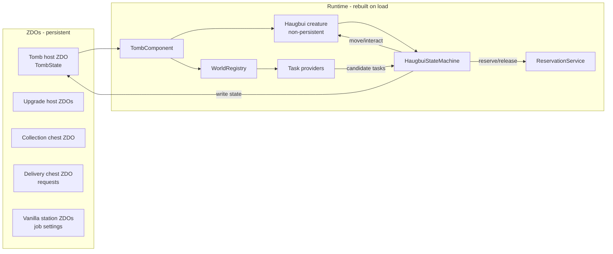
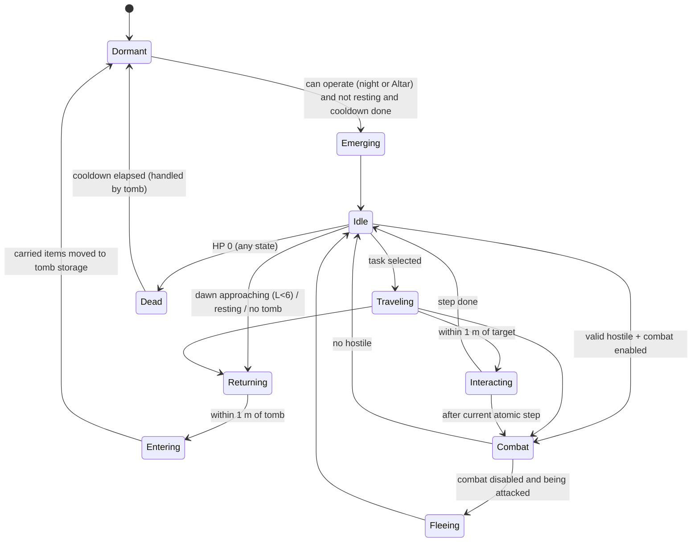

# Haugbui — Architecture

Target: Valheim 1.0.17 · BepInEx 5.4.23 · Jötunn 2.30.2 · C# / .NET Framework 4.8 (Windows).
Companion documents: `TECHNICAL_FEASIBILITY.md` (verified facts), `PRODUCT_REQUIREMENTS.md` (behaviour).

## 1. Principles

1. **The world is the database.** All persistent state lives in ZDO keys on world objects (tomb, chests, stations).
   Runtime objects are caches that can be rebuilt from ZDOs at any time.
2. **The Haugbui creature is a projection of its tomb.** It is non-persistent; the tomb ZDO owns its HP, carried
   inventory, death time and settings. Spawning/despawning the creature never loses data.
3. **One brain, one actuator.** Only the `HaugbuiStateMachine` issues movement and interaction commands. Feature
   systems (storage, delivery, harvest, production, combat) *propose* tasks; they never move the creature.
4. **Game access is isolated.** Every call into Valheim types (RPC names, ZDO keys, private fields) goes through the
   `Integration/` adapter layer, so a game update breaks one place, and the domain logic stays unit-testable.
5. **Transfers are single-frame and owner-checked.** An item leaves a source and enters a destination in the same
   frame, only when this peer owns both ZDOs. World saves snapshot ZDOs on the main thread between frames, so a save never
   observes a half-moved item. [V — spike HB-T-009, 2026-10-13: 120 s of random destination-first moves between two
   chests with a forced save every 5 s, then reload: item totals unchanged]
6. **Owner-authoritative execution.** All Haugbui logic runs only on the peer that owns the tomb's ZDO (in
   single-player: the local player). This keeps the door open to server-authoritative multiplayer.
7. **No custom items. Host prefabs for structures.** See feasibility §9.2.

## 2. Solution layout

```
haugbui-valheim-mod/
├─ Haugbui.sln
├─ Directory.Build.props        (version, VALHEIM_INSTALL / VALHEIM_MANAGED resolution, imports Environment.props)
├─ Environment.props            (git-ignored, per developer: VALHEIM_INSTALL, MOD_DEPLOYPATH)
├─ nuget.config                 (nuget.org + BepInEx feed)
├─ src/
│  ├─ Haugbui/                  (BepInEx plugin, net48; Jötunn/BepInEx compile-only; game DLLs publicized at build)
│  │  ├─ HaugbuiPlugin.cs
│  │  ├─ Config/                HaugbuiConfig, ProgressionTable binding
│  │  ├─ Integration/           adapters over Valheim: ZdoKeys, GameApiSelfCheck, ContainerGateway, ItemDropGateway,
│  │  │                         StationAdapters/, PickableGateway, AccessPolicy, TimeSource, PlacementRules
│  │  ├─ Registry/              WorldRegistry (containers, stations, harvestables, item drops, beds), spatial index
│  │  ├─ Structures/            HostPrefabSystem, TombComponent, UpgradeComponent, CollectionChest, DeliveryChest
│  │  ├─ Creature/              HaugbuiCreature (prefab setup), HaugbuiController, Movement, Visuals, Combat actuator
│  │  ├─ Brain/                 HaugbuiStateMachine, TaskPlanner, ITaskProvider implementations
│  │  ├─ Coordination/          ReservationService
│  │  ├─ Persistence/           TombState, StationJobState, DeliveryRequestState (ZDO serializers), WorldGuard
│  │  ├─ UI/                    TombPanel, DeliveryPanel, ProductionPanel, CountdownLabel, Warnings
│  │  ├─ Patches/               Harmony patches (thin; delegate to systems)
│  │  ├─ Diagnostics/           Log, console commands (haugbui_status, haugbui_dump_prefabs, ...)
│  │  ├─ Spikes/                DEBUG-only spike commands (HB-T-007/009/090)
│  │  └─ Translations/          English/haugbui.json, Portuguese_Brazilian/haugbui.json (auto-loaded by Jötunn)
│  └─ Haugbui.Core/             (netstandard2.0, NO Unity/Valheim refs) pure domain logic:
│                               ProgressionTable, TickScheduler, PieceRecipe/RecipeValidator, GameApiManifest/Checker,
│                               ItemRules, StorageSelector, DeliveryLedger, ProductionJob, ReservationTable,
│                               cooldown math, state-machine transition rules
├─ tests/
│  └─ Haugbui.Core.Tests/       (NUnit, runs with `dotnet test` without the game)
├─ docs/
└─ .reference/                  (git-ignored: game DLLs + decompiled source for API lookup only)
```

`Haugbui.Core` is merged into the plugin assembly at build time (ILRepack) or shipped as a second DLL in the same
plugin folder (simpler; chosen by default).

## 3. Component map

| Concept (spec §23-C) | Implementation | Layer |
|---|---|---|
| HaugbuiPlugin | `HaugbuiPlugin : BaseUnityPlugin` — `[BepInPlugin]`, `[BepInDependency(Jotunn)]`, `[NetworkCompatibility(EveryoneMustHaveMod, Minor)]`; wires config, localization, prefabs, patches, registries | Plugin |
| HaugbuiConfiguration | `HaugbuiConfig` (BepInEx `ConfigFile` bindings, admin-only flags for future sync) | Config |
| HaugbuiLocalization | `HaugbuiLocalization` (`LocalizationManager.Instance.GetLocalization()`; token helper `L.T("haugbui_x")`) | Localization |
| HaugbuiAttributes | `ProgressionTable` (Core) + `HaugbuiAttributes` snapshot (level → capacity, speed, radius, slots, HP) | Core |
| HaugbuiTomb | `TombComponent` (MonoBehaviour on the tomb host) + `TombState` (ZDO-backed) | Structures/Persistence |
| HaugbuiUpgradeManager | `UpgradeComponent` + `TombLevelService` (level = 1 + distinct bound upgrades, any order; abilities granted per upgrade kind) | Structures |
| HaugbuiController | `HaugbuiController` (on the creature) — owns references to state machine, movement, inventory view, visuals | Creature |
| HaugbuiStateMachine | `HaugbuiStateMachine` (Brain) — single source of movement/interaction commands | Brain |
| HaugbuiMovementController | `HaugbuiMovement` — kinematic flight, arrival detection (≤1 m), smoothing | Creature |
| HaugbuiInventory | `CarriedInventory` — wraps a vanilla `Inventory(w=slots,h=1)` + weight cap; serialised into tomb ZDO | Persistence |
| HaugbuiStorageManager | `StorageTaskProvider` + `StorageSelector` (Core) | Brain/Core |
| HaugbuiCollectionManager | `CollectionTaskProvider` (Collection Chest + ground items) | Brain |
| HaugbuiDeliveryManager | `DeliveryTaskProvider` + `DeliveryLedger` (Core) | Brain/Core |
| HaugbuiHarvestManager | `HarvestTaskProvider` + `PickableGateway` | Brain/Game |
| HaugbuiCombatManager | `CombatTaskProvider` (interrupt source) + `CombatActuator` | Brain/Creature |
| HaugbuiProductionManager | `ProductionTaskProvider` + `ProductionJob` (Core) | Brain/Core |
| ProductionStationAdapter | `IStationAdapter` + `SmelterAdapter`, `FermenterAdapter`, `CookingStationAdapter`, `FuelOnlyAdapter` | Game |
| HaugbuiPersistenceManager | `ZdoStore` (typed get/set, versioned blobs), `WorldGuard` (marker, detection, backup) | Persistence |
| (coordination) | `ReservationService` (in-memory leases) + persistent job ownership on station ZDO | Coordination |
| (access) | `IAccessPolicy` → `SinglePlayerAccessPolicy` (wards via `PrivateArea.CheckAccess`, container privacy) | Game |
| (time) | `ITimeSource` → `WorldTimeSource` (`ZNet.GetTimeSeconds`, `EnvMan.IsNight/IsDay/GetDayFraction`) | Game |

## 4. Runtime topology



- `WorldRegistry` keeps live sets of containers, stations, pickables, beehives, item drops, beds, Haugbui
  structures, populated by Harmony postfixes on `Awake`/`OnDestroy` (vanilla has no container list) plus
  `ItemDrop.s_instances`. Queries use a coarse spatial hash (cell 16 m).
- `TombComponent` (owner-only `Update` at a configurable tick, default 0.5 s) decides whether the creature should exist
  (night/level/cooldown/resting), spawns it at the tomb (emergence VFX) or recalls it.
- The creature's `HaugbuiController` runs the state machine at its own tick (default 0.25 s) with movement in `Update`.

## 5. State machine

States (persisted subset in **bold** inside `TombState.state`):



- **Dormant / Dead / Cooldown** are tomb states (creature absent). **Emerging, Idle, Traveling, Interacting, Combat,
  Returning, Entering** exist only while the creature is spawned.
- Interrupts: Combat > Returning(dawn) > tasks. An interrupt never splits an atomic interaction step (e.g. moving one
  stack); it waits for the step to finish (≤ 1 tick).
- On load, a spawned creature never resumes mid-task: the tomb respawns it (if allowed) at its last saved position or
  at the tomb, in Idle, and tasks are re-planned from persistent state.

### 5.1 Task model

```csharp
interface ITaskProvider {
  TaskKind Kind { get; }
  bool IsEnabled(TombSnapshot tomb);                 // toggles, level gates
  void Collect(PlanningContext ctx, List<TaskCandidate> output);  // cheap, time-sliced
}
sealed class TaskCandidate {
  TaskKind Kind; int Priority; Vector3 FirstTarget; ReservationKey[] Keys; Func<TaskPlan> Build;
}
```

Planner picks the highest-priority candidate whose reservation keys are all free, reserves them, builds a `TaskPlan`
(ordered steps: `GoTo(target)`, `Take(container,item,n)`, `Put(container,item,n)`, `Pick(pickable)`,
`Extract(beehive)`, `Feed(station, item, n)`, `CollectOutputs(station)`, `PickUpDrop(drop)`), and executes it.

Default priority order (configurable later): Combat (interrupt) → deposit when carried inventory full → production
output pickup (avoid ground clutter) → production feeding → delivery requests → harvesting → collection chest →
ground items → idle hover near tomb.

## 6. Coordination between Haugbuis

- `ReservationService` (singleton per world session) maps `ReservationKey` (`ZDOID` of target + optional item
  prefab hash/slot) to `{tombId, leaseExpiry}`. Leases default 30 s, renewed while the task runs, released on
  completion, on creature despawn/death, and **cleared entirely on world load** (never persisted).
- Keys used:
  - Ground item drop → its ZDOID (exclusive).
  - Pickable/beehive/nest → ZDOID (exclusive).
  - Container *for writing* → ZDOID (exclusive for the duration of a single Take/Put step only).
  - Station → ZDOID (exclusive while feeding/collecting).
  - Delivery request line → (chest ZDOID, item hash).
- **Persistent ownership** (survives reloads): a station's automation job stores `haugbui_job_tomb = <tombGuid>`. The
  first Haugbui whose radius covers it claims it; others skip it. If the owning tomb is gone/unloaded for > N minutes
  of world time, another tomb may take over. The Delivery Chest is served by any Haugbui (ledger is on the chest).
- Capacity races are impossible in single-player because all transfers are single-frame on the same peer;
  reservations prevent *planning* conflicts (two Haugbuis flying to the same drop).

## 7. Inventory and transfer service

`TransferService.Move(source, destination, itemPrefab, amount)`:
1. Validate both ends exist, are loaded, are owned by this peer (`ZNetView.IsOwner()`; request ownership through the
   vanilla flow otherwise and retry next tick), are not `IsInUse()`, pass `IAccessPolicy`.
2. Compute `n = min(amount, available in source, capacity in destination (slots + stacks), weight cap if destination is
   the carried inventory)`.
3. **Destination first, then source** (same principle as the "Dvergr Tidier" mod: "every move puts the item in its
   destination before removing it from where it was"): add `n` to the destination preserving `ItemData` fields
   (`m_quality`, `m_worldLevel`, `m_cheated`, `m_customData`), read back how many were actually accepted, then remove
   exactly that amount from the source — all in the same frame. A failure can therefore never lose an item; the worst
   case (a crash between the two writes, only possible in future multiplayer) is a duplicate, never a loss. Never call
   `Inventory.AddItem(..., dropIfFullInv: true)`.
   Verified pitfalls of `Inventory.AddItem(ItemData)` (Inventory.cs:112, 1.0.17): it **inserts the instance it receives**
   and mutates its `m_stack`/`m_gridPos`, so always pass `item.Clone()`; and when the stack only partly fits it tops up
   existing stacks first and then returns `false` **without rolling back** what it already added. Always check
   `CanAddItem` first. `CanAddItem` counts stack space by name and world level but `AddItem` stacks by name, quality
   and world level, so for quality > 1 items compute capacity with the quality-aware rule in Core.
4. Persist: containers save themselves via `OnContainerChanged` (owner); carried inventory is serialised into the tomb
   ZDO immediately.
5. Debug ledger (when `DebugLogging`): log `{tomb, op, item, n, src, dst, totals before/after}` to detect drift.

**Interruption rule:** whenever the Haugbui stops working (dawn, Rest toggle, death, tomb unloaded, combat flee that
ends at the tomb), everything it carries is moved to **tomb storage**, which the player can open at any time. When it
emerges again, tomb storage is its first sorting source (like a Collection Chest). The player can therefore always
take what the servant was carrying while it sleeps, and nothing stays "in limbo".

Carried inventory = vanilla `Inventory(name, null, slots, 1)`, weight checked manually (vanilla `CanAddItem` ignores
weight). Equipment filter applied at every entry point via `ItemRules.IsTransportable(ItemData)` (Core).

## 8. Persistence model

All keys are namespaced `haugbui_*` and versioned. Blobs are `ZPackage` byte arrays with a leading schema version.

| Object | Keys |
|---|---|
| Any Haugbui host | `haugbui_kind` (int: Tomb, Collection, Delivery, Upgrade1..5), `haugbui_ver` (int), `haugbui_guid` (string) |
| Tomb | `haugbui_owner` (long playerID), `haugbui_state` (int), `haugbui_hp` (float), `haugbui_carried` (byte[] inventory), `haugbui_overflow` (byte[] inventory), `haugbui_death_time` (double as long bits), `haugbui_cooldown` (float), `haugbui_toggles` (int bitmask: ground, harvest, combat, production, resting, combat_ack), `haugbui_pos` (Vec3 last creature position), `haugbui_level_cache` (int, display only) |
| Upgrade | `haugbui_tomb_guid` (binding, written on placement), upgrade kind in `haugbui_kind` |
| Delivery chest | `haugbui_requests` (byte[]: list of {itemPrefab, requested, delivered}) |
| Vanilla station | `haugbui_job` (byte[]: {enabled, recipe input/output prefab, mode finite/infinite, target, supplied, produced, tombGuid}) |
| World | global key `haugbui <schemaVersion>`; `haugbui_tombs <count>` |

Rules:
- Never write defaults over existing data: readers return `null` for missing blobs; writers only run after a successful
  read (protects against wiping data on partial load).
- Schema migration functions per blob version; unknown future versions → read-only + warning.
- Level is **recomputed** from upgrades in range; the cached value is only for UI when upgrades are unloaded.

### 8.1 Host-prefab system

```mermaid
sequenceDiagram
  participant P as Player (build hammer)
  participant G as Placeholder piece (custom prefab)
  participant HS as HostPrefabSystem
  participant H as Vanilla host (e.g. piece_chest_wood)
  P->>G: PlacePiece (vanilla resource consumption)
  G->>HS: Start() on owner, ZDO new
  HS->>H: Instantiate host at same pos/rot
  HS->>H: copy creator; set haugbui_kind/guid/ver
  HS->>G: ZNetScene.Destroy(placeholder)
  Note over H: On every load: Awake postfix sees haugbui_kind<br/>→ attach TombComponent/Chest behaviour + visuals
```

Supporting patches: deconstruction refund (drop Haugbui recipe instead of host cost), hover/interact override,
`Container.Awake` adjustments (size/name) before `Load`, exclusion from vanilla/3rd-party auto-storage where possible
(`MUC_Ignore`). **Decision (spike HB-T-007, 2026-10-13): go.** The `Container.Awake` postfix, look swap and
missing-mod survival work on 1.0.17; the placeholder → host swap and refund patch are built and tested in HB-T-014.
Fallback (standard Jötunn prefabs) stays documented only.

## 9. Production adapters

```csharp
interface IStationAdapter {
  bool CanHandle(GameObject station);
  StationKind Kind { get; }                       // Smelter, Fermenter, Cooking, FuelOnly
  IReadOnlyList<RecipeOption> GetRecipes();        // from m_conversion (read at runtime)
  StationSnapshot Read();                          // queue size, fuel, ready outputs, blocked reasons
  int InputCapacity(RecipeOption r);               // free queue slots
  int FuelNeeded();                                // to keep the queue burning
  void Feed(ItemData input, bool cheated);         // InvokeRPC("RPC_AddOre"/"RPC_AddItem")
  void AddFuel();                                  // InvokeRPC("RPC_AddFuel")
  Vector3 OutputPoint { get; }                     // ground drops are collected around it
  int YieldPerInput(RecipeOption r);               // 1 for smelters; m_producedItems for fermenter
  bool IsBlocked(out string reasonToken);          // no roof, no wind, smoke blocked, exposed...
}
```

- Adapters live in `Integration/StationAdapters/`; `StationAdapterRegistry` picks the first adapter whose `CanHandle` is true.
  Adding a station = one new adapter class + registration + localization keys (see DEVELOPMENT_GUIDE).
- `ProductionJob` (Core) tracks `supplied` (inputs fed by Haugbuis) and `produced` (= supplied × yield, confirmed when
  outputs are collected). Finite target counts **products of this job**; the job stops feeding when
  `supplied × yield ≥ target`, then completes after outputs are collected.
- Inputs are taken from eligible storage minus quantities reserved by Delivery Chest requests (`DeliveryLedger`).
- `CookingStationAdapter` is **dawn-aware**: without the Altar it only loads an item if cook time + collection margin ends
  before the Haugbui must return; done items have top task priority (prevents burning).
- No adapter for `CraftingStation` recipes in v1 (PRD HB-122). A V2 `RecipeCraftingAdapter` would gather
  `m_resources`, check `IsRecipeKnown`, station level and `CheckUsable`, and swap resources for products in one frame;
  `IStationAdapter` already allows adding it without touching the planner.
- Manual use is respected: the Haugbui never removes queued inputs; it only tops up to capacity, so a player can
  still add items manually. A station whose queue holds a different input than the job recipe is left alone until
  empty ("manual use detected" status).

## 10. Combat

- `CombatTaskProvider` scans the registry's characters near the tomb (every 1 s) and validates targets via
  `ITargetPolicy` (Core rules + Game facts): alive, not player, not tamed, not Haugbui, has `MonsterAI`, not
  `AnimalsVeg`/`Players` faction, within operational radius, in loaded zone, combat toggle on and acknowledged.
- The Haugbui character is set **tamed** (no `Tameable` component) so vanilla AI never targets players/tamed animals
  and enemies treat it as a valid target. Its `MonsterAI` is neutralised; `CombatActuator` aligns, closes to attack
  range and calls the vanilla `Humanoid` attack with its default weapon (cloned/tuned `wraith_melee`).
- Multiple Haugbuis may attack the same enemy (no reservation needed: damage is idempotent per hit).

## 11. Movement

- Owner-only. Rigidbody kinematic during Haugbui control; `Collider.excludeLayers` / `Rigidbody.excludeLayers`
  include `piece`, `piece_nonsolid`, `static_solid`, `Default`, `Default_small`, `terrain`, `vehicle` — so it is not
  blocked, while staying on the `character` layer so it can be hit.
- Steering: straight line with smoothed acceleration (max speed from progression), altitude = max(target height,
  ground height + 0.5 m) while travelling, descending to the interaction point for the last metres.
- Arrival: distance from the creature's interaction point to the target's closest collider point ≤ 1.0 m
  (`Interaction.MaxDistance`, config).
- No teleports during ordinary activity; the only teleport-like transitions are emergence/entering, covered by VFX.

## 12. UI

| UI | Entry point | Built with |
|---|---|---|
| Tomb panel | `E` on tomb (hover shows level/state/cooldown) | Jötunn woodpanel: stats, carried inventory grid (read-only view), overflow, toggles, rest button |
| Tomb storage | Button in tomb panel → vanilla container UI via request-open flow | Vanilla `InventoryGui` |
| Delivery panel | `E` opens vanilla chest UI; `Shift+E` opens request editor | Jötunn panel: item picker (known materials), quantity, requested/delivered/remaining |
| Production panel | `Shift+E` on supported station (Switch/Interactable patch) | Jötunn panel: enable, recipe dropdown, finite/infinite, target, progress |
| Countdown | World-space TMP label on tomb, 1 Hz | TMP + `Billboard` |
| Warnings | Combat warning on first longsword placement/toggle; world-guard warning on load | `UnifiedPopup` + `YesNoPopup` |

UI never mutates state directly: it sends commands to the owning system (`TombCommands.SetToggle(...)`), which
validates and writes the ZDO (future MP: routed RPC to the owner).

## 13. Configuration and localization

- `HaugbuiConfig` sections: `General` (debug logging, effects quality), `Progression` (per-level arrays as CSV strings
  with defaults from the spec), `Timing` (tick intervals), `Death` (cooldown seconds, clock), `Production` (unlock
  level, allowed station kinds), `Construction` (bed distance, tomb spacing), `Combat`. Admin-only attributes set
  for future sync.
- Localization keys: `haugbui_<area>_<name>` in `Translations/English/haugbui.json` and
  `Translations/Portuguese_Brazilian/haugbui.json`; code references `$haugbui_*` only. A unit test ensures both files have
  identical key sets.

## 14. Remote worker ("away mode")

When the tomb ZDO exists but its zone is not instantiated (player away), `RemoteWorkerService` (single instance,
ticks every `RemoteTickSeconds`, default 10 s) runs each tomb's abstract worker directly on ZDO data:

- Same rules as the physical Haugbui: night/level gating via `ITimeSource`, toggles, storage rule, delivery ledger,
  reservations, access policy (ward data read from `PrivateArea` ZDOs), equipment filter.
- Work is throttled by a simulated travel budget (`distance / speed` per step + fixed interaction time), so remote
  throughput never exceeds what the physical servant could do.
- Supported remotely: tomb storage / Collection Chest → storage chests; Delivery Chest requests; smelter/kiln/refinery
  queue + fuel top-up within capacity (writes the same ZDO keys the vanilla `QueueOre`/`SetFuel` write; key list in
  `Haugbui.Core/GameApi/GameApiManifest.cs`). Not supported remotely: harvesting, output collection, cooking, combat.
- Container data is edited through a temporary `Inventory` (`Load` from `s_items`, modify, `Save` back); the
  destination-first rule applies.
- Hand-over: when the zone loads, the remote worker stops for that tomb and the physical Haugbui takes over (state
  rebuilt from ZDOs); when it unloads, the reverse. Never both at once (tomb runtime flag + ownership check).
- Risk: writing private vanilla keys must match game behaviour exactly; covered by a spike and the API self-check.

### 14.1 Sleep fast mode

`SleepFastMode` (owner-side) is active while `EnvMan.IsTimeSkipping()`. Each frame it adds the world-time delta
(only the part where the Haugbui may work) to a per-tomb budget; the state machine then runs the next planned steps
with `HaugbuiMovement.TeleportTo` instead of flight while the budget covers `distance / speed + interactionTime`.
Combat and flee states are suspended. The same budget model backs the away-mode worker (§14), so both share
`WorkBudget` in Core.

## 15. Multiplayer readiness (not in v1)

Already designed for: owner-only execution, ZDO-backed state, UI→command layer, `IAccessPolicy` per owner ID,
`[NetworkCompatibility]`. Future work: routed RPC commands, vanilla container request-open flow before transfers,
dedicated-server NRE workarounds (`Pickable.RPC_Pick`, `CookingStation.SpawnItem`), ownership hysteresis for the tomb.

## 16. Error handling and diagnostics

- Startup self-check: reflection verifies every private member/RPC name the mod relies on; missing → log error and
  disable the affected feature (never crash the game).
- All patches wrapped in try/catch with rate-limited logging.
- Console commands (Jötunn `ConsoleCommand`): `haugbui_status`, `haugbui_reservations`, `haugbui_ledger`,
  `haugbui_plan` (dry run), `haugbui_cleanup` (orphan creatures), `haugbui_kill`, `haugbui_cooldown_skip`,
  `haugbui_dump_tomb`, `haugbui_dump_prefabs`.
